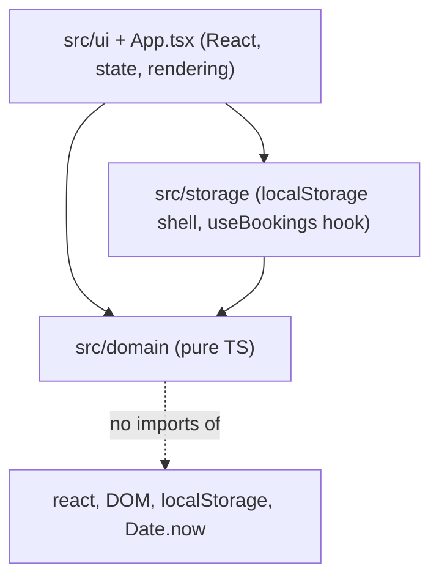
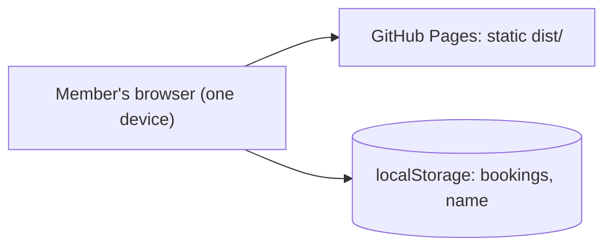

# Architecture Spine — Meeting-Room Booking

## Design Paradigm

**Functional core / imperative shell.** Rules are pure functions over plain data; side effects (storage, clock, DOM) live at the edge and are passed in.



Dependency direction is one-way: `ui` → `storage` → `domain`; `ui` may also import `domain` for pure queries. `domain` imports nothing outside itself.

## Invariants & Rules

### AD-1 — Booking is the only persisted entity; everything else is derived [ADOPTED: PRD §3]

- **Binds:** FR-1, FR-2, FR-6, FR-9, FR-12
- **Prevents:** Stored availability/busyness/allowance counters that drift from the bookings list.
- **Rule:** Persist only `Booking[]` and the remembered Name. Day grids, Busyness, remaining allowance and "my bookings" are pure functions of `(bookings, …)` in `src/domain/`, recomputed on render. Rooms are constants in `src/domain/rooms.ts` (`small | medium | large`, capacity, projector) and are never persisted. `Booking = { id: string, roomId, date, startSlot, slotCount, name }`, `id` from `crypto.randomUUID()` generated in the storage shell (`crypto.randomUUID()` when available, else a `getRandomValues` fallback, since it needs a secure context) and passed in on the request; the domain never generates ids. A Booking is stored and handled as `startSlot` + `slotCount` only; code never keeps an `endSlot` (end is exclusive `startSlot + slotCount`, derived).

### AD-2 — One time model: Athens date strings and integer slots

- **Binds:** FR-1, FR-2, FR-4, FR-5, FR-6
- **Prevents:** Device-zone bugs, off-by-one slot maths, two units representing time differently.
- **Rule:** A date is a `'YYYY-MM-DD'` string meaning a calendar day in Europe/Athens. A time is an integer slot index `0..23` (slot 0 = 08:00–08:30, slot 23 = 19:30–20:00); a Booking covers `[startSlot, startSlot + slotCount)` with `slotCount` 1..4. Overlap is interval intersection on that half-open range, so back-to-back is allowed. `src/domain/time.ts` is the only place that converts an instant to Athens date + minutes (via `Intl.DateTimeFormat` with `timeZone: 'Europe/Athens'`, `hourCycle: 'h23'`, read with `formatToParts`); no `getHours()`/`getDate()`/`toLocale*` on device-zone `Date` anywhere else. Day-window arithmetic adds days to the y/m/d parts (UTC calendar math), never 24 h to an instant. A slot is past when its start is before `now`, so the in-progress slot is unavailable [ASSUMPTION: PRD FR-1 does not define it]. A Booking is finished when its end is at or before `now`; otherwise it is upcoming (FR-9). `time.ts` exports the one public API every unit uses: `athensDate(now)`, `athensSlotIndex(now)`, `windowDates(now)`, `slotLabel(slot)` (`HH:mm`) and `formatDate(date)`; no other module formats times or dates.

### AD-3 — The clock is an argument

- **Binds:** FR-1, FR-4, NFR-tests
- **Prevents:** Untestable "today" logic; midnight/DST tests that need fake timers.
- **Rule:** Domain functions never read the system clock. They take `now: Date` (an instant). Only the UI shell calls `new Date()`, and re-evaluates it on user actions (not on a timer requirement). Tests pass fixed instants, including around Athens midnight and the March/October DST changes.

### AD-4 — Mutations go through two domain functions returning a Result

- **Binds:** FR-4, FR-5, FR-6, FR-8, FR-10
- **Prevents:** Rules re-implemented (or skipped) in components; inconsistent error handling; order-dependent outcomes.
- **Rule:** `createBooking(bookings, request, now)` and `cancelBooking(bookings, id, requesterName, now)` in `src/domain/` are the only code that may produce a new `Booking[]`. `request` is `{ id, roomId, date, startSlot, slotCount, name }`. `Result<T, E> = { ok: true, value: T } | { ok: false, error: E }`; `createBooking` yields `{ bookings, created }` (so the UI can confirm the new Booking), `cancelBooking` yields `{ bookings }`. Rule failures never throw. Finished Bookings still count toward the Daily Allowance and cannot be cancelled (`in_past`). `DomainError` is a discriminated union on `code` carrying data (e.g. `overlap` with `conflicts: Booking[]` sorted by `startSlot`, `allowance_exceeded` with remaining minutes, `outside_grid`, `bad_length`, `outside_window`, `in_past`, `name_required`, `not_owner`, `not_found`). The domain builds no user-facing strings; the UI maps `code` → message. `createBooking` checks in fixed order: name, length/grid, window, past, overlap, allowance, and returns the first failure. The UI may call domain predicates to disable controls, but enforcement happens only inside these two functions.

### AD-5 — Names compare through one key function

- **Binds:** FR-6, FR-7, FR-8, FR-9, FR-10
- **Prevents:** Allowance and cancel disagreeing about who "Eleni K." is.
- **Rule:** `nameKey(name) = name.normalize('NFC').trim().toLowerCase()` (locale-independent; inner whitespace is not collapsed) in `src/domain/name.ts`. Every Name comparison - allowance, ownership, own-bookings list - uses `nameKey`; nobody compares raw strings. A stored Booking keeps the trimmed name as typed, for display. Empty `nameKey` is refused (`name_required`).

### AD-6 — Storage is one shell module with read-modify-write commits

- **Binds:** FR-5, FR-7, FR-12, SM-1
- **Prevents:** Two tabs on one device overwriting each other's Bookings; crashes on bad data; scattered `localStorage` calls.
- **Rule:** Only `src/storage/` touches `localStorage`. The `useBookings` hook is the only storage API the UI sees: it exposes `bookings`, `currentName`, `book(request-without-id)`, `cancel(id)` and `setName(name)`; `book` and `cancel` act under `currentName` and return the domain `Result`. `currentName` is the single "who am I" - the booking form edits it via `setName`, and My Bookings and Cancel read it. Bookings live under key `room-booking:v1` as `{ version: 1, bookings: Booking[] }`; the Name under `room-booking:name`. A commit re-reads storage, applies the domain function to that fresh list, writes the result, then publishes it to React state. Loaded data is shape-validated; missing, corrupt or wrong-version data yields an empty list without throwing and is treated as empty (a later commit overwrites it). Storage that is unavailable or full returns an error Result that the UI shows. React state is a view of storage, updated on `storage` events from other tabs (including `key === null`, i.e. `clear()`).

### AD-7 — UI holds view state only; no router, no state library

- **Binds:** FR-1, FR-2, FR-3, FR-11
- **Prevents:** Competing navigation/state approaches and new runtime dependencies.
- **Rule:** The selected day, room and booking draft live in React state/hooks. Navigation is in-page (no URL routing), so GitHub Pages needs no rewrite rules. Components are function components with hooks; plain CSS in `src/styles.css`, mobile-first (phone width is the base, desktop is a media-query enhancement). Visible text states that Bookings are on this device only (FR-12).

### AD-8 — Derived views have fixed shapes

- **Binds:** FR-1, FR-2, FR-9
- **Prevents:** Two views of one day disagreeing on "past" vs "booked", and "full"/"empty" meaning different things.
- **Rule:** The day-grid query returns, per Room, 24 cells each with independent `booking: Booking | null` and `past: boolean`; a cell can be both. Busyness is an integer `bookedSlots` 0..24 per Room per date (empty = 0, full = 24); presentation derives any ratio. Own Bookings = upcoming Bookings whose `nameKey` matches, sorted by date then `startSlot`.

### AD-9 — Architecture rules are enforced by a test

- **Binds:** AD-2, AD-3, AD-6, AD-7
- **Prevents:** Silent breaches of purity and the single-owner rules (no linter in the repo).
- **Rule:** A Vitest test (`src/architecture.test.ts`, no new dependency) scans sources and fails if: `src/domain/` imports `react` or outside itself, or uses `Date.now`, `new Date()` with no argument, `localStorage`; any file outside `src/storage/` uses `localStorage`; any file outside `src/domain/time.ts` uses `getHours`, `getDate`, `getDay` or `toLocale*`. `npm run verify` therefore enforces them.

## Consistency Conventions

| Concern | Convention |
| --- | --- |
| Naming | Files `kebab-case.ts(x)`; components `PascalCase`; domain types `Booking`, `RoomId`, `DomainError`, `Result`; room ids `small \| medium \| large`. |
| Data & formats | Dates `'YYYY-MM-DD'` (Athens); times as slot ints in code, `HH:mm` only when rendering (derived from slot); durations in slots in code, minutes in messages; ids are UUID strings. |
| State & cross-cutting | Immutable updates (domain returns new arrays); no global mutable state; no `any`/`@ts-ignore`; errors are `Result` values, not exceptions; no network calls. Changing the remembered Name never rewrites existing Bookings. |
| Tests | `*.test.ts(x)` next to source. Every domain rule: boundary slots (08:00, 20:00), back-to-back, exactly 2 h, 2 h + 1 slot, allowance across rooms, name case/space, Athens midnight, DST dates, order independence of overlap. Storage tests use jsdom `localStorage`. UI tests via Testing Library cover the booking and cancel flows. |

## Stack

| Name | Version |
| --- | --- |
| Node | CI runs `.nvmrc` (24); jsdom 30.1.3 needs ^22.22.2 or ^24.15 or >=26 (package.json `engines` says >=22.12.0, see Deferred) |
| @testing-library/dom | 10.4.2 |
| React / React DOM | 19.3.1 |
| TypeScript (strict, `noUncheckedIndexedAccess`) | 7.0.2 |
| Vite + @vitejs/plugin-react | 8.3.4 / 6.1.2 |
| Vitest + jsdom | 5.0.5 / 30.1.3 |
| @testing-library/react | 16.3.3 |
| Platform APIs | `Intl.DateTimeFormat`, `localStorage`, `crypto.randomUUID` |
| Hosting | GitHub Pages (static `dist/`, `base` from `BASE_PATH`) |

## Structural Seed



Deployment and environments: local `npm run dev`, and production on GitHub Pages via the existing `deploy.yml`. No servers, secrets, config files or runtime environment variables. Operations: none beyond CI; a bad release is fixed by redeploying.

```text
src/
  domain/    # pure TS: rooms, time, name, rules (createBooking, cancelBooking), queries (day grid, busyness, allowance, own bookings) + tests
  storage/   # localStorage shell, versioned envelope, useBookings hook + tests
  ui/        # React components: week overview, day view, booking form, my bookings
  App.tsx    # composition, view state
  styles.css
```

## Capability → Architecture Map

| Capability / Area | Lives in | Governed by |
| --- | --- | --- |
| FR-1 Day view | `domain` day-grid query, `ui` day view | AD-1, AD-2, AD-3 |
| FR-2 Week overview | `domain` busyness query, `ui` week view | AD-1, AD-2 |
| FR-3 Room facts | `domain/rooms.ts`, `ui` | AD-1 |
| FR-4 Create Booking | `domain` createBooking | AD-2, AD-3, AD-4 |
| FR-5 No double bookings | `domain` createBooking, `storage` commit | AD-2, AD-4, AD-6 |
| FR-6 Daily Allowance | `domain` createBooking | AD-4, AD-5 |
| FR-7 Name memory | `storage`, `ui` | AD-5, AD-6 |
| FR-8 Name matching | `domain/name.ts` | AD-5 |
| FR-9 Own Bookings | `domain` query, `ui` | AD-1, AD-5 |
| FR-10 Cancel | `domain` cancelBooking | AD-4, AD-5 |
| FR-11 Mobile first | `ui`, `styles.css` | AD-7 |
| FR-12 Local storage notice | `storage`, `ui` | AD-6, AD-7 |
| NFR tests / offline | `*.test.ts(x)`; no network code | Conventions, AD-6 |

## Deferred

- `package.json` `engines` (>=22.12.0) is looser than jsdom 30's Node requirement; changing it is outside this task's scope - raise with the human.
- Shared storage across devices, real identity, cross-device double-booking guarantee: needs a backend; a scope change for the human (PRD §5, addendum).
- Recurring bookings, room displays, notifications, admin, editing: out of MVP scope.
- Visual design, component breakdown, copy for error messages: story-level.
- Deep-linkable URLs (hash routing): add only if a story needs it; no dependency allowed.
- Accessibility depth beyond tappable targets and semantic controls: story-level.
